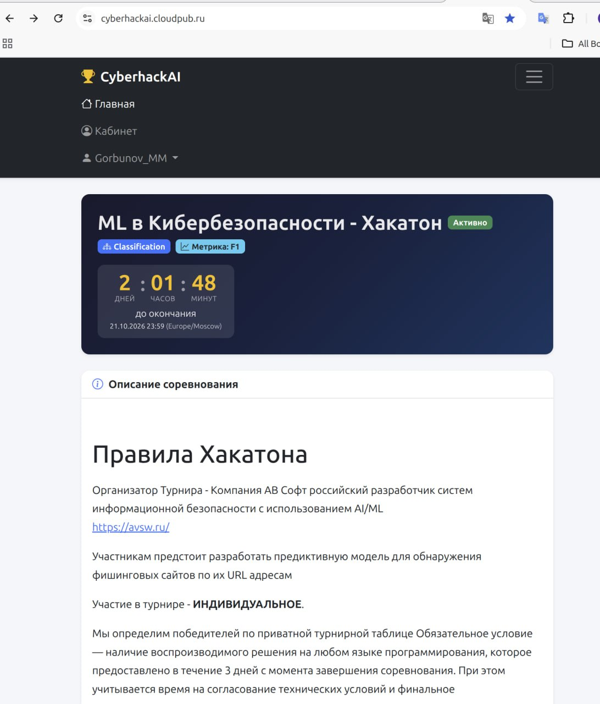

# Обнаружение фишинговых сайтов по URL

Решение хакатона «ML в кибербезопасности» (платформа Cyberhackai, АВ Софт, октябрь 2026).
Задача: по строке URL определить, фишинговый это сайт (1) или безопасный (0). Метрика: F1.

Результат: **8-е место из 15 участников** по приватной части теста.

| Оценка | F1 |
| --- | --- |
| Приватная часть теста (12 800 строк) | 0.9954 |
| Публичная часть теста (3 200 строк) | 0.9964 |
| Кросс-валидация по train (5 фолдов, 64 000 строк) | 0.9942 |

Файл ответов с максимальной приватной оценкой: `submissions/sub_blend4.csv`.
Эта версия воспроизводит его бит в бит (см. [Быстрая проверка](#быстрая-проверка)).

Участие индивидуальное, аккаунт на платформе: **Gorbunov_MM** (см. [Авторство](#авторство)).

## Содержание

- [Что изменено в этой версии](#что-изменено-в-этой-версии)
- [Идея решения](#идея-решения)
- [Структура репозитория](#структура-репозитория)
- [Установка](#установка)
- [Быстрая проверка](#быстрая-проверка)
- [Полное воспроизведение](#полное-воспроизведение)
- [Смоук-тест](#смоук-тест)
- [Сторонние данные](#сторонние-данные)
- [Что давало прирост](#что-давало-прирост)
- [Честность решения](#честность-решения)
- [Ограничения](#ограничения)
- [Авторство](#авторство)

## Что изменено в этой версии

Цель изменений: упростить сопровождение и повторный запуск, ускорить пайплайн и сделать оценку
качества стека честнее. Результаты исходной версии при этом не сдвигаются.

**Проверка эквивалентности.** Обе версии прогнаны на одних и тех же синтетических данных
(`tests/make_synth.py`) с `PHISH_JOBS=8`. Все промежуточные вероятности совпали бит в бит
(максимальная разница 0.0): четыре текстовые модели, `stack4`, оба раунда псевдоразметки,
kNN-признаки, `stack9s`, `stack9cat`, `stack10`, `stack11`. По приложенным вероятностям
`blend.py` собирает `sub_blend3.csv` и `sub_blend4.csv`, побайтно совпадающие с загруженными на платформу.

**Структура кода**
- `src/common.py`: единые пути, seed, фолды, загрузка данных и разбор URL. В исходной версии
  функции `host` / `split` / `host_of` были скопированы в шесть скриптов с мелкими расхождениями.
- `src/text_models.py` заменил четыре почти одинаковых скрипта (`baseline_tfidf.py`, `tfidf_models.py`,
  `text_pl.py`, `text_pl2.py`). Модели описаны один раз, режим псевдоразметки задаётся флагами
  `--pl`, `--thr`, `--suffix`.
- Разбор аргументов через `argparse` (`--help` у каждого шага) вместо ручного разбора `sys.argv`.
- Артефакты перенесены из корня репозитория в `artifacts/features/` и `artifacts/preds/`.
  Пути переопределяются переменными `PHISH_DATA`, `PHISH_ART`, `PHISH_SUBS`, `PHISH_JOBS`.

**Скорость**
- Лексические признаки (`features.build_v2`): URL разбирается один раз вместо двух, регулярки
  предкомпилированы, признаки брендов (100 расстояний Левенштейна) кэшируются по домену.
  На 80 000 синтетических URL время сократилось с 29.6 до 10.3 с (в 2.9 раза).
- Результат `build_v2` кэшируется в `artifacts/cache/` по хэшу списка URL. В исходной версии
  он пересчитывался в каждом из шести запусков `stack_lgb.py`, теперь считается один раз.
- Четыре текстовые модели шагов 1-2 обучаются параллельно (раньше последовательно).
  Ускорение зависит от числа ядер: на 2 ядрах 132 → 112 с, на 16 ядрах ожидается больше.
- Число потоков LightGBM, CatBoost и kNN берётся из `PHISH_JOBS` (по умолчанию все ядра).
  В исходной версии было жёстко задано 8 или 12. Для бит-в-бит повторения исходного прогона нужно `PHISH_JOBS=8`:
  при другом числе потоков порядок суммирования в гистограммах LightGBM меняется, и вероятности
  расходятся в последних знаках.

**Методика**
- `stack_lgb.py --honest-es`. В исходной версии ранняя остановка выполнялась на том же
  валидационном фолде, по которому потом считается OOF F1, поэтому число деревьев подбиралось под
  оцениваемые строки, и OOF-оценка была оптимистичной. С флагом под раннюю остановку отрезается 10%
  обучающей части фолда, а валидационный фолд используется только для оценки. На синтетике
  OOF F1 стека снижается с 0.9651 до 0.9628. Это и есть величина оптимизма на маленькой выборке;
  на реальных 64 000 строках её нужно перемерить. По умолчанию флаг выключен, чтобы
  воспроизводить приложенные результаты. Для всех стеков сразу: `STACK_FLAGS=--honest-es ./run_all.sh`.
- Файлы `submissions/sub_stack*.csv` отдельных стеков пишутся с порогом 0.5, как в финальной смеси.
  Раньше порог подбирался на тех же OOF. Подобранный порог по-прежнему печатается, но с пометкой
  о том, что эта оценка оптимистична. Финальные `blend*` не меняются.
- `blend.py` работает без `data/train.csv`: для быстрой проверки данные с платформы не нужны.

**Проверяемость**
- `tests/smoke.sh` прогоняет весь `run_all.sh` на синтетических данных с заглушками внешних источников
  за 2-3 минуты, без сети и без данных платформы.

## Идея решения

Решение двухуровневое.

**Первый уровень.** Четыре линейные модели на TF-IDF по символьным n-граммам URL:
по всему адресу (символы 1-5 плюс слова), по хосту, по пути со строкой запроса
и широкая модель по всему адресу (символы 1-6, обучение через SGD). Каждая даёт
вероятность фишинга. Для train это out-of-fold вероятности: модель не видела строку,
для которой предсказывает. Модели дообучены с псевдоразметкой теста: в обучение
добавлены строки теста, метка которых надёжно известна из открытых датасетов
или в которой стек предыдущего шага уверен на 99 процентов и выше.

**Второй уровень.** Градиентный бустинг (LightGBM и CatBoost) примерно на 100 признаках:

- вероятности первого уровня;
- лексика URL: длины, число точек и дефисов, цифры, энтропия, IP вместо домена,
  punycode, ключевые слова вроде login и verify, бесплатные хостинги, сокращатели ссылок;
- бренды: упоминание известного бренда не на его домене, опечатки в домене
  (расстояние Левенштейна до бренда не больше 2);
- доля фишинга по зарегистрированному домену, считается out-of-fold;
- признаки из открытых списков фишинга и размеченных датасетов (см. ниже);
- живые проверки: резолвится ли хост в DNS, дата регистрации и статус домена по RDAP.

**Финальный ответ.** Среднее вероятностей четырёх стеков второго уровня
(LightGBM с усреднением по 5 seed, CatBoost, LightGBM с признаками ближайших соседей,
LightGBM на втором раунде псевдоразметки), порог 0.5.

## Структура репозитория

```
.
├── README.md
├── run_all.sh                 полный прогон всех шагов одной командой
├── requirements.txt           версии ключевых библиотек
├── requirements_full.txt      полный pip freeze исходного прогона
├── environment.txt            процессор, ядро, версия Python исходного прогона
├── src/
│   ├── common.py              пути, seed, фолды, разбор URL
│   ├── text_models.py         шаги 1, 2, 5, 5а: TF-IDF-модели, в том числе с псевдоразметкой
│   ├── features.py            лексические признаки и признаки брендов (с кэшем)
│   ├── ext_feats.py           шаг 3: признаки из сторонних источников
│   ├── stack_lgb.py           шаги 4 и 7: бустинг второго уровня
│   ├── dns_feats.py           шаг 6: DNS-проверки хостов
│   ├── rdap_feats.py          шаг 6: данные о регистрации доменов
│   ├── knn_feats.py           шаг 6: признаки ближайших соседей
│   └── blend.py               шаг 8: смесь стеков, финальный файл
├── tests/
│   ├── make_synth.py          синтетические данные и заглушки признаков
│   └── smoke.sh               прогон всего пайплайна на синтетике
├── data/                      сюда кладутся train.csv и test.csv с платформы
├── ext/rdap_bootstrap.json    таблица RDAP-серверов IANA
├── artifacts/
│   ├── features/              ext_feats.csv, dns_feats.csv и rdap_feats.csv (снимки от 13.10.2026), knn_feats.csv
│   └── preds/                 вероятности четырёх финальных стеков (oof_*.npy, test_*.npy)
├── submissions/               sub_blend3.csv, sub_blend4.csv
└── docs/                      скриншот страницы соревнования (раздел «Авторство»)
```

## Установка

Проверено на Linux x86_64, Python 3.10.12, 16 ядер CPU, 31 ГБ RAM, без GPU.
Нужен Python 3.10 или новее. Команды выполняются из корня репозитория:

```bash
python3 -m venv .venv
.venv/bin/pip install -r requirements.txt
```

Файлы `train.csv` и `test.csv` с платформы положить в папку `data/`.

## Быстрая проверка

Вероятности четырёх финальных стеков приложены (`artifacts/preds/`), поэтому финальный файл
собирается за несколько секунд без переобучения и без данных платформы:

```bash
cp submissions/sub_blend4.csv /tmp/submitted.csv
.venv/bin/python src/blend.py blend4 stack9s stack9cat stack10 stack11
cmp submissions/sub_blend4.csv /tmp/submitted.csv && echo identical
```

## Полное воспроизведение

```bash
./run_all.sh
```

Скрипт выполняет шаги 1-8 подряд, около 2 часов на 16 ядрах в исходной версии.
Все seed равны 42, разбиение на фолды `StratifiedKFold(5, shuffle=True, random_state=42)`
задаётся в одном месте (`common.folds`).

По шагам:

1-2. `src/text_models.py`: четыре текстовые модели (весь URL, хост, путь, широкая SGD-модель).
3. `src/ext_feats.py`: признаки из сторонних источников, нужны скачанные файлы в `ext/`.
   Готовый результат приложен, по умолчанию шаг пропускается.
4. `src/stack_lgb.py stack4 --ext`: промежуточный стек, его уверенность нужна для псевдоразметки.
5. `src/text_models.py --pl stack4 --thr 0.99 --suffix _pl`: текстовые модели с псевдоразметкой теста.
6. `src/dns_feats.py`, `src/rdap_feats.py`, `src/knn_feats.py`: живые проверки и соседи.
   Снимки DNS и RDAP приложены и по умолчанию не пересчитываются.
   Пересчитать шаги 3 и 6 заново: `REBUILD_EXT=1 ./run_all.sh`.
7. `src/stack_lgb.py` с флагами `--ext --dns --rdap` и вариантами `--seeds 5`, `--cat`, `--knn`:
   четыре стека второго уровня; между ними второй раунд псевдоразметки (`--suffix _pl2`).
8. `src/blend.py`: смесь стеков и финальный файл.

Повторить исходный прогон бит в бит: `PHISH_JOBS=8 ./run_all.sh`.

## Смоук-тест

```bash
PY=.venv/bin/python tests/smoke.sh
```

Генерирует синтетические train/test и заглушки внешних признаков во временной папке и прогоняет
весь `run_all.sh`. Тест проверяет, что шаги запускаются и связаны друг с другом. Качество модели
на синтетике ничего не говорит.

## Сторонние данные

Правила хакатона разрешают сторонние данные. Использованы только открытые источники,
скачанные 12-13 октября 2026 (в скобках папка, откуда их читает `src/ext_feats.py`):

| Источник | Что даёт | Папка |
| --- | --- | --- |
| [ealvaradob/phishing-dataset](https://huggingface.co/datasets/ealvaradob/phishing-dataset), файл urls.json | размеченные URL | ext/hf_ealv/ |
| [kmack/Phishing_urls](https://huggingface.co/datasets/kmack/Phishing_urls), parquet | размеченные URL | ext/hf_kmack/ |
| [pirocheto/phishing-url](https://huggingface.co/datasets/pirocheto/phishing-url), parquet | размеченные URL | ext/hf_piro/ |
| [UCI PhiUSIIL](https://archive.ics.uci.edu/dataset/967/phiusiil+phishing+url+dataset) | размеченные URL | ext/phiusiil/ |
| [Phishing.Database](https://github.com/mitchellkrogza/Phishing.Database): phishing-links-ACTIVE.txt, phishing-links-INACTIVE.txt, phishing-domains-ACTIVE.txt | списки фишинга | ext/phishdb/ |
| [PhishTank](http://data.phishtank.com/data/online-valid.csv.bz2), распаковать | список фишинга | ext/phishtank/ |
| [OpenPhish](https://openphish.com/feed.txt) | список фишинга | ext/openphish/ |
| [Tranco](https://tranco-list.eu/top-1m.csv.zip), распаковать | популярность доменов | ext/tranco/ |
| [IANA RDAP bootstrap](https://data.iana.org/rdap/dns.json) | адреса RDAP-серверов | ext/rdap_bootstrap.json (приложен) |

Списки фишинга обновляются ежедневно, поэтому повторное скачивание даст немного другие файлы.
Для точного воспроизведения итог этого шага (`artifacts/features/ext_feats.csv`) приложен к репозиторию.

## Что давало прирост

| Шаг | F1 кросс-валидация | F1 публичная часть |
| --- | --- | --- |
| TF-IDF + логистическая регрессия | 0.958 | 0.968 |
| + лексические признаки, стек | 0.967 | 0.976 |
| + четыре текстовые модели, бренды | 0.973 | 0.979 |
| + списки фишинга и Tranco | 0.981 | 0.990 |
| + размеченные публичные датасеты | 0.991 | 0.992 |
| + псевдоразметка теста | 0.992 | 0.994 |
| + DNS-проверки | 0.993 | 0.996 |
| + RDAP, усреднение по seed, смесь стеков | 0.994 | 0.996 |

Все загрузки на платформу, для справки:

| Файл | Public F1 | Private F1 |
| --- | --- | --- |
| sub_blend4.csv | 0.996390 | 0.995403 |
| sub_blend3.csv | 0.996063 | 0.995319 |
| sub_stack9.csv | 0.996064 | 0.995070 |
| sub_stack9s.csv | 0.996064 | 0.994904 |
| sub_stack7s.csv | 0.996391 | 0.994150 |
| sub_stack7.csv | 0.995736 | 0.993902 |
| sub_stack6.csv | 0.994091 | 0.992811 |
| sub_stack4.csv | 0.992446 | 0.992141 |
| sub_stack3.csv | 0.989491 | 0.984673 |
| sub_stack2.csv | 0.978964 | 0.979496 |
| sub_lgb_stack.csv | 0.976328 | 0.976204 |

Оставшиеся ошибки на кросс-валидации (около 280 из 64 000) в основном приходятся на шум разметки:
например, login.yahoo.com помечен в train как фишинг, а mail-customer-support.com как безопасный сайт.

## Честность решения

- Меток теста решение не использует ни в каком виде.
- Все признаки, зависящие от меток (вероятности первого уровня, доля фишинга по домену,
  соседи kNN), считаются out-of-fold.
- Псевдоразметка берёт только строки теста с меткой из открытых датасетов или с уверенностью
  модели от 99 процентов; оценка качества всегда идёт по исходным меткам train.
- Лидерборд не зондировался: за соревнование сделано 12 загрузок, каждая - новая версия модели.
- Порядок строк теста проверен на утечку: корреляция метки с номером строки равна нулю.

## Ограничения

- Модель видит только строку URL. Фишинг на взломанном старом сайте с нейтральным путём
  без анализа содержимого страницы неотличим от легитимной страницы.
- DNS- и RDAP-признаки отражают состояние на октябрь 2026. На свежем фишинге в боевом режиме
  признак "хост не резолвится" слабее, а возраст домена сильнее.
- На URL, которых нет ни в одном открытом источнике, F1 модели около 0.983.

## Авторство

Решение подготовлено индивидуально, как того требуют правила турнира. На платформе Cyberhackai
я участвовал под аккаунтом **Gorbunov_MM**. Ниже страница соревнования из моего личного кабинета,
снята во время турнира, за двое суток до окончания приёма решений (21.10.2026 23:59 МСК):

<p align="center">
  
</p>
